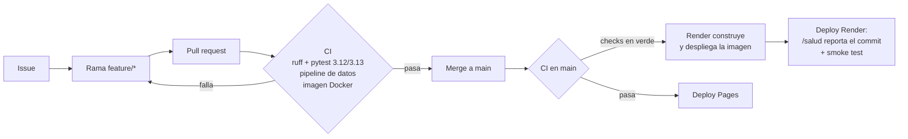

# EA3 · App web con CI/CD en GitHub Actions y despliegue en Render

[](https://github.com/NeiderJPCuervo/EA3-DevOps-Scraping-GalaxyA55/actions/workflows/ci.yml)
[](https://github.com/NeiderJPCuervo/EA3-DevOps-Scraping-GalaxyA55/actions/workflows/deploy-render.yml)
[](https://github.com/NeiderJPCuervo/EA3-DevOps-Scraping-GalaxyA55/actions/workflows/deploy.yml)

**App en producción (Render):** https://ea3-galaxy-a55.onrender.com · [API (`/docs`)](https://ea3-galaxy-a55.onrender.com/docs) · [`/salud`](https://ea3-galaxy-a55.onrender.com/salud)
**Tablero estático (GitHub Pages):** https://neiderjpcuervo.github.io/EA3-DevOps-Scraping-GalaxyA55/

Evidencia de aprendizaje 3 de *Programación para Análisis de Datos*
(Ingeniería de Software y Datos, IU Digital). Autor: John Neider Cuervo Quintero.

El proyecto continúa la **EA1** (scraper del Samsung Galaxy A55 en Mercado Libre Colombia con
Selenium, BeautifulSoup y Scrapy) y la **EA2** (flujo DevOps con issues, ramas, pull requests,
CI y despliegue del tablero en GitHub Pages). En la EA3 el análisis se convierte en una
**aplicación web** que se prueba, se empaqueta en Docker y se despliega sola en la nube:

- **App FastAPI** ([`app/main.py`](app/main.py)): tablero HTML y API REST con filtros;
- **Docker**: imagen liviana, usuario sin privilegios y `HEALTHCHECK`;
- **CI** en GitHub Actions: ruff, 56 pruebas con pytest en Python 3.12 y 3.13, pipeline de
  datos fuera de línea y construcción + smoke test de la imagen Docker;
- **CD**: Render despliega `main` solo cuando el CI está en verde y un workflow verifica que
  producción sirva el commit validado.

## La app

| Ruta | Qué devuelve |
|---|---|
| [`/`](https://ea3-galaxy-a55.onrender.com/) | Tablero con indicadores, gráficas y las 30 publicaciones del A55 |
| [`/salud`](https://ea3-galaxy-a55.onrender.com/salud) | Estado, commit desplegado y entorno (health check y verificación del CD) |
| [`/api/resumen`](https://ea3-galaxy-a55.onrender.com/api/resumen) | Indicadores del análisis en JSON |
| [`/api/publicaciones`](https://ea3-galaxy-a55.onrender.com/api/publicaciones?condicion=Nuevo) | Publicaciones con filtros `condicion`, `capacidad`, `precio_max`, `limite` |
| `/api/publicaciones/{id}` | Una publicación por su id `MCO…` (404 si no existe) |
| [`/docs`](https://ea3-galaxy-a55.onrender.com/docs) | Documentación OpenAPI interactiva |

El plan gratuito de Render apaga el servicio tras unos minutos sin tráfico: la primera
petición puede tardar unos 50 segundos.

## Flujo DevOps y pipeline CI/CD



| Workflow | Disparador | Qué hace |
|---|---|---|
| [`ci.yml`](.github/workflows/ci.yml) | pull request y push a `main` | `ruff check`, `pytest --cov` en 3.12 y 3.13, BeautifulSoup + Scrapy + análisis fuera de línea; job `docker`: build, run, smoke test con `curl` y `HEALTHCHECK`. El check `ci` agrupa todo y lo exige la protección de `main` |
| [`deploy-render.yml`](.github/workflows/deploy-render.yml) | CI exitoso en `main` (`workflow_run`) o manual | Espera a que `https://ea3-galaxy-a55.onrender.com/salud` reporte el commit validado y hace smoke test de la API en producción (environment `produccion`) |
| [`deploy.yml`](.github/workflows/deploy.yml) | CI exitoso en `main` o manual | Regenera datos, figuras y el sitio estático y lo publica en GitHub Pages |

Render está configurado con [`render.yaml`](render.yaml) (Blueprint): servicio Docker en plan
free, `healthCheckPath: /salud` y `autoDeployTrigger: checksPass`, es decir, **Render solo
despliega un commit de `main` cuando sus checks de GitHub Actions pasan**. Así nada llega a
producción sin pruebas en verde y no hace falta guardar tokens de Render en GitHub.

### ¿Por qué el CI no hace scraping en vivo?
Mercado Libre redirige a una verificación anti-bot (`/gz/account-verification`) las
peticiones que no vienen de un navegador real, y los servidores de GitHub tampoco
tienen sesión gráfica para Selenium. En vez de evadir esa protección, el pipeline
trabaja sobre el HTML que Selenium capturó en `data/raw/` (25 de octubre de 2026).
La captura en vivo se hace a mano con `01_selenium_navegador.py`.

## Estructura

```
app/main.py               app web FastAPI (tablero + API)
Dockerfile                imagen de producción (con .dockerignore)
render.yaml               Blueprint de Render
scraping/
  config.py               URL, selectores CSS, cortesía y rutas (EA2_SALIDA)
  parsers.py              limpieza y parseo compartidos
  01_selenium_navegador.py captura del listado y la ficha (navegador real)
  02_bs4_listado.py       requests + BeautifulSoup (--local usa data/raw/)
  ml_scrapy/              proyecto Scrapy: spider, item y pipeline de limpieza
  04_analisis.py          pandas + matplotlib → resumen.json y figuras
  06_sitio.py             tablero HTML (GitHub Pages y la app web)
tests/                    pytest: unitarias, integración y regresión
data/raw/                 HTML capturado por Selenium (entrada de las pruebas)
.github/workflows/        ci.yml, deploy-render.yml y deploy.yml
```

## Uso local

```bash
python3 -m venv .venv && source .venv/bin/activate
pip install -r requirements-dev.txt
ruff check .
pytest --cov
uvicorn app.main:app --reload          # http://127.0.0.1:8000
```

Con Docker, igual que en producción:

```bash
docker build -t ea3-galaxy-a55 .
docker run --rm -p 8000:8000 ea3-galaxy-a55
```

Pipeline completo sin conexión, escribiendo en `salida/` en lugar de `data/`:

```bash
export EA2_SALIDA=$PWD/salida
cd scraping
python 02_bs4_listado.py --local
(cd ml_scrapy && scrapy crawl galaxy_a55 -a origen=local)
python 04_analisis.py
python 06_sitio.py          # genera site/index.html
```

## Resultados del análisis

| Indicador | Valor |
|---|---|
| Publicaciones extraídas (3 páginas) | 119 |
| Publicaciones que son un Galaxy A55 | 30 |
| Precio mediano | $874.950 |
| Mediana nuevo (n=5) / usado (n=24) | $1.895.180 / $829.950 |
| Con envío gratis | 90 % |

## Ética del scraping
Se respeta `robots.txt` (`ROBOTSTXT_OBEY = True`), con 3 s entre peticiones, una conexión
y un User-Agent que identifica el proyecto como académico. No se evaden
verificaciones anti-bot y solo se recogen datos públicos de las publicaciones.

Consulte [CONTRIBUTING.md](CONTRIBUTING.md) para conocer el flujo de ramas y commits.
